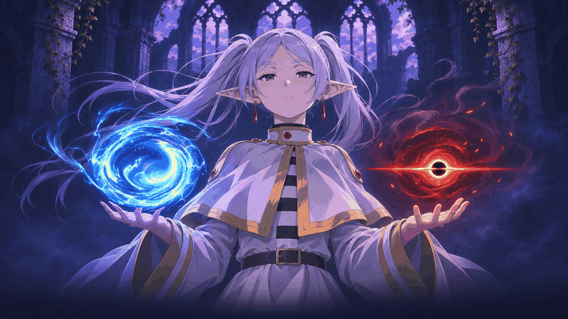
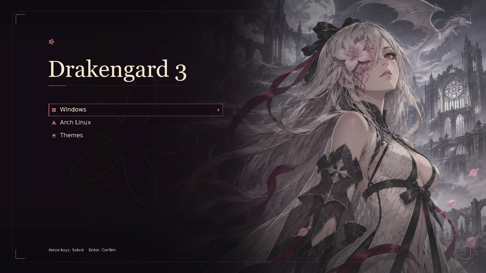
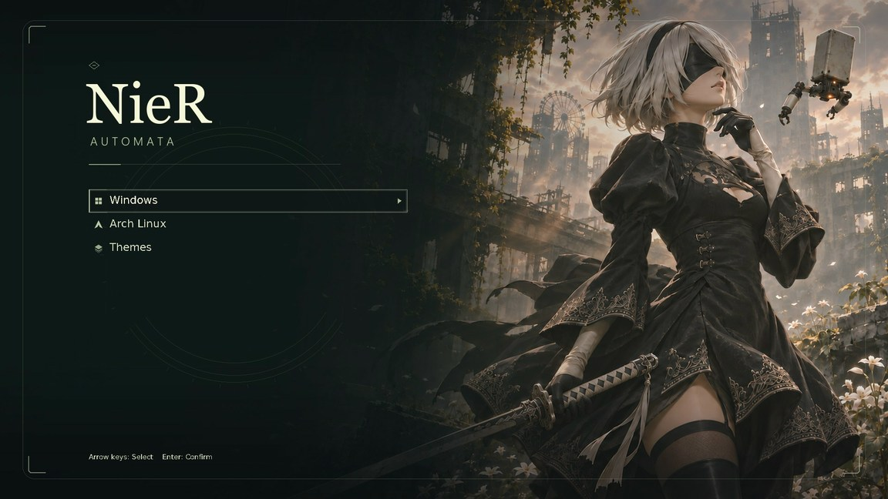
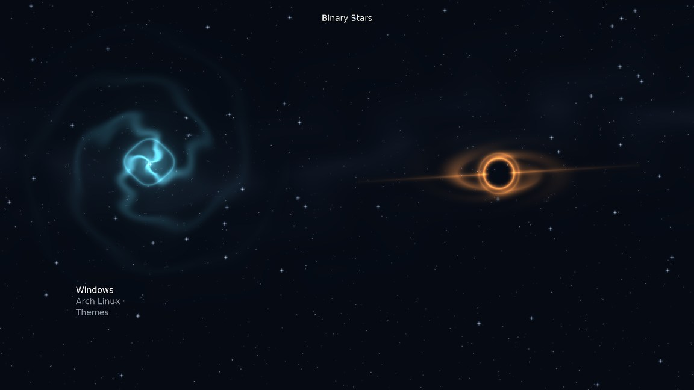
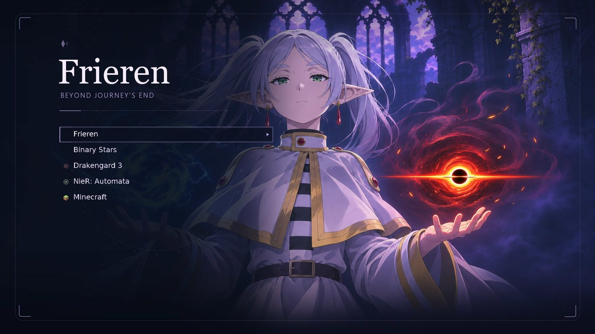

# BetterGRUB

BetterGRUB gives GNU GRUB themes animated regions that respond to the selected boot entry. In the Frieren theme, both hands continuously shed magic. Focus **Windows** to expand the blue spell into a bright, turbulent corona. Focus **Arch Linux** and Doom grows, bends the painting around its rim, and pulls some escaping blue filaments into a tightening orbit.



The animation above is recorded from the UEFI framebuffer in QEMU/OVMF. The renderer runs inside GNU GRUB 2.14 on x86-64 UEFI and targets 30 frames per second. The theme defines both lenses and their connection. [Frieren theme files](examples/frieren)

## Theme gallery

**Drakengard 3** — Zero on the steps of a ruined cathedral, with a rose-colored menu. [Theme files](examples/drakengard3)



**NieR: Automata** — 2B in an overgrown city, with a muted green menu. [Theme files](examples/nier-automata)



**Binary Stars** — a procedural star field with two independent, selection-driven lenses. [Theme files](examples/binary-stars)



**Frieren theme picker** — the separate illustration behind the theme-selection menu. [Picker layout](examples/frieren/picker.txt)



The demo also includes Lxtharia's **Minecraft** world-selection and title screens. Select Minecraft, then open **Themes → Minecraft Title Screen** to reach the panorama. [Bundled theme and credits](examples/minecraft/NOTICE.txt) · [Original Double Minegrub Menu](https://github.com/Lxtharia/double-minegrub-menu)

## Try the demo

Download **BetterGRUB-demo.zip** from the preview release. On Linux, run these commands with the path to the downloaded ZIP. [BetterGRUB 0.2.0](https://github.com/SEIka1/BetterGRUB/releases/tag/v0.2.0)

```sh
git clone https://github.com/SEIka1/BetterGRUB.git
cd BetterGRUB
python3 tools/preview.py /path/to/BetterGRUB-demo.zip
```

The preview opens a disposable VM. Use **Up** and **Down** to change focus. Press **T** to choose a theme. The Windows and Arch Linux entries demonstrate selection and return to the menu when activated. A reset of the VM keeps the selected theme for the rest of that session.

The preview uses QEMU, OVMF, dosfstools, mtools and `sfdisk`. On Debian or Ubuntu they are available in `qemu-system-x86 ovmf dosfstools mtools fdisk`. For other firmware layouts, set `OVMF_CODE` and `OVMF_VARS` to a matching pair of firmware files.

On a Linux host with access to KVM, run `QEMU_ACCEL=kvm python3 tools/preview.py` for hardware-accelerated playback. The default uses QEMU's software CPU emulator.

## Make a theme

Add a `desktop-lens` line for each animated region in your `theme.txt`. Coordinates are pixels in the original image, measured from its top-left corner.

```text
desktop-image: "scene.jpg"
desktop-image-scale-method: "stretch"
desktop-lens: "windows vortex 248 383 488 360 #71dcff 56 112 48"
desktop-lens: "arch eclipse 1230 413 508 320 #ff993e 46 102 42 windows"
```

GRUB matches the first word to a menu entry's `--class`. The last number sets the ambient strength. Naming `windows` at the end of the `arch` line makes that lens draw material from the blue vortex when focused. You can use your own class names and artwork. [Theme authoring guide](docs/theme-authoring.md)

## Build from source

Use an x86-64 Linux host with a C toolchain, GNU Make, binutils, Bison, Flex, GNU awk, gettext, texinfo, liblzma development headers, pkg-config, patch, xz, curl and Python 3.

```sh
sh build.sh
python3 tools/preview.py --smoke build/BetterGRUB-demo.zip
```

The build downloads and checks the SHA-256 of the GNU release, applies the compositor patch and packages a matching EFI image and module directory. `GRUB_TARBALL` can point to a local copy of the release. `JOBS` controls build parallelism. The smoke test checks spell growth, moving material between the two lenses, background restoration, the five themes and theme persistence after a firmware reset. [Upstream GNU GRUB releases](https://ftp.gnu.org/gnu/grub/)

## Try it from an existing GRUB

Extract the complete `EFI/BetterGRUB` directory onto your EFI System Partition. At the command prompt of an existing UEFI GRUB, enter the following commands. The firmware's **Boot from EFI file** option can also open `EFI/BetterGRUB/BetterGRUB.efi` directly.

```grub
search --file --set=root /EFI/BetterGRUB/BetterGRUB.efi
chainloader /EFI/BetterGRUB/BetterGRUB.efi
boot
```

The preview EFI is unsigned. Secure Boot requires an EFI image accepted by your firmware's trust policy. To make real OS entries, adapt the demo's `EFI/BetterGRUB/grub/grub.cfg` using the kernel, initrd and chainloader commands from your working configuration. Keep the matching BetterGRUB modules in that same installation.

## License

BetterGRUB's code is available under GPL-3.0-or-later. The fan illustrations, procedural artwork, Minegrub assets and fonts have separate credits and notices. [Software license](LICENSE) · [Art and fonts](ARTWORK.md)
